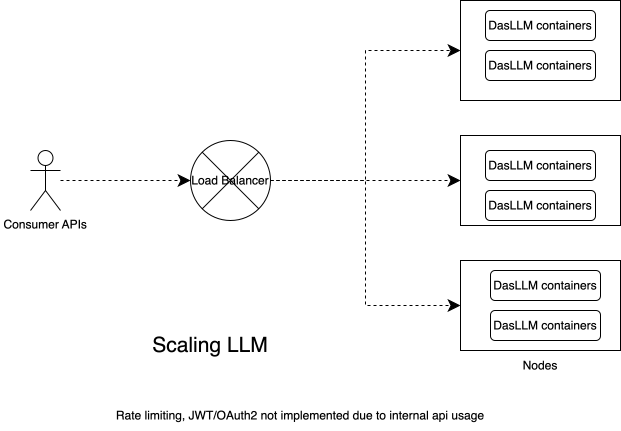

# DasLLM
This is a custom llm hosted on my computer and exposed an API to be used by agent. Later on, this LLM will be used for Agents. 

```
| Process for self hosting |
                                                        |
                                                        ▼
                                        -----------------------------------                                                                                                     
                                       |   Choose an LLM from HuggingFace  |
                                        -----------------------------------                  
                                                        |
                                                        ▼
                                         ----------------------------------
                                        |  Try it locally to see the       |
                                        |  quality of LLM response and.    |
                                        |  change LLM if required          |
                                          ---------------------------------
                                                        |                                                     
                                                        ▼
                                         ---------------------------------------
                                        |  Download Tokenizer and model Tensors |
                                        |  Load model from local repo and test. |
                                         ---------------------------------------
                                                        |
                                                        ▼
                                         --------------------------------------
                                        |  Create POST API, Load model Tensors |
                                        |  in GPU, add inputs to GPU, get      |
                                        |  response and return                 |
                                         --------------------------------------
                                                        |
                                                        ▼
                                          -------------------------------------
                                         |         Secure API with tokens      |
                                          -------------------------------------
                                                         |
                                                         ▼    

                                                                                                                                                       
```
> [!NOTE]
> Download and put model in LLM/Model repo according to download_model.py and install requirements.txt, model not included in git due to size.

> [!IMPORTANT]
> Latency observed: 1m to 4m, depending upon the length of thinking process and complexity of prompt.

A lightweight, high-performance REST API for local Large Language Model (LLM) inference built with **FastAPI**, **Hugging Face Transformers**, and **PyTorch**.

Supports reasoning models (e.g., Qwen series) with native chain-of-thought separation, splitting the internal reasoning (`thinking_content`) from the final answer (`content`).

---

## Features

- **Local Inference**: Self-hosted model serving directly from local weights in `LLM/Model/`.
- **Reasoning / Chain-of-Thought Extraction**: Automatically parses and separates `<think>...</think>` tokens from the final response.
- **Hardware Acceleration**: Automatically detects and leverages Apple Silicon GPU (`mps`) with seamless fallback to `cpu`.
- **FastAPI Lifespan Management**: Efficiently loads model weights once during application startup and unloads on shutdown.
- **Threadpool Offloading**: Synchronous generation runs in worker threads to keep FastAPI's event loop non-blocking and responsive.

---

## Project Structure

```text
API/
├── LLM/
│   ├── Model/                # Local model directory (safetensors, tokenizer, config)
│   │   ├── config.json
│   │   ├── model.safetensors
│   │   ├── tokenizer.json
│   │   └── tokenizer_config.json
│   └── llm.py                # Model loader & reasoning parser wrapper
├── main.py                   # FastAPI server, endpoints, and lifespan handler
├── requirements.txt          # Python dependencies
└── README.md                 # Project documentation
```

---

## Prerequisites

- **Python**: 3.10+ (tested on Python 3.12)
- **PyTorch**: Compatible with your OS and GPU backend (Metal/MPS on macOS, CUDA on Linux/Windows, or CPU)
- Model files placed inside `LLM/Model/`

---

## Installation

1. **Clone or navigate to the repository:**
   ```bash
   cd API
   ```

2. **Create and activate a virtual environment:**
   ```bash
   python3 -m venv .venv
   source .venv/bin/activate
   # On Windows: .venv\Scripts\activate
   ```

3. **Install dependencies:**
   ```bash
   pip install -r requirements.txt
   ```

4. **Verify Model Weights:**
   Ensure your model files (safetensors, `config.json`, tokenizer files) are placed in:
   ```text
   API/LLM/Model/
   ```

---

## Running the Server

### Development Mode (Direct execution)
```bash
python main.py
```
The server will start at `http://localhost:8000`.

### Production / Reload Mode via Uvicorn CLI
```bash
uvicorn main:app --host 0.0.0.0 --port 8000 --reload
```

---

## API Documentation

Interactive Swagger documentation is automatically available at:
- **Swagger UI**: [http://localhost:8000/docs](http://localhost:8000/docs)
- **ReDoc**: [http://localhost:8000/redoc](http://localhost:8000/redoc)

### Endpoint: Generate LLM Response

- **URL**: `/api/v1/llm`
- **Method**: `POST`
- **Content-Type**: `application/json`

#### Request Body
```json
{
  "prompt": "How many r's are in strawberry?"
}
```

#### Response Body
```json
{
  "thinking_content": "The user is asking for the count of the letter 'r' in the word 'strawberry'...",
  "content": "There are 3 'r's in the word \"strawberry\" (st**r**awbe**rr**y)."
}
```

---

## Example Usage

### cURL
```bash
curl -X POST "http://localhost:8000/api/v1/llm" \
     -H "Content-Type: application/json" \
     -d '{"prompt": "Explain quantum computing in one sentence."}'
```

### Python (`requests`)
```python
import requests

url = "http://localhost:8000/api/v1/llm"
payload = {"prompt": "Write a haiku about coding."}

response = requests.post(url, json=payload)
data = response.json()

if data.get("thinking_content"):
    print("--- Thinking Process ---")
    print(data["thinking_content"])

print("\n--- Final Answer ---")
print(data["content"])
```

---

## How It Works

1. **Model Loading ([LLM/llm.py](LLM/llm.py))**:
   The `LLM` class initializes the tokenizer and causal language model from `LLM/Model/` and mounts them onto `mps` (Apple Silicon) or `cpu`.

2. **Chat Template Formatting**:
   The prompt is formatted using `apply_chat_template` with `enable_thinking=True` and `add_generation_prompt=True` to activate reasoning tokens.

3. **Thinking Separation**:
   After generation, the token stream is analyzed for the closing thinking token `151668` (`</think>`). The text before this token is decoded as `thinking_content`, and the text following it is returned as `content`.

### Scaling

